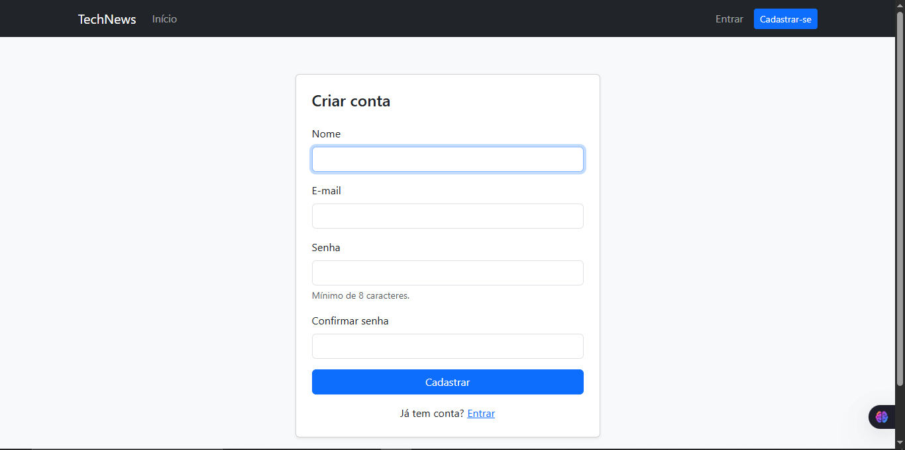
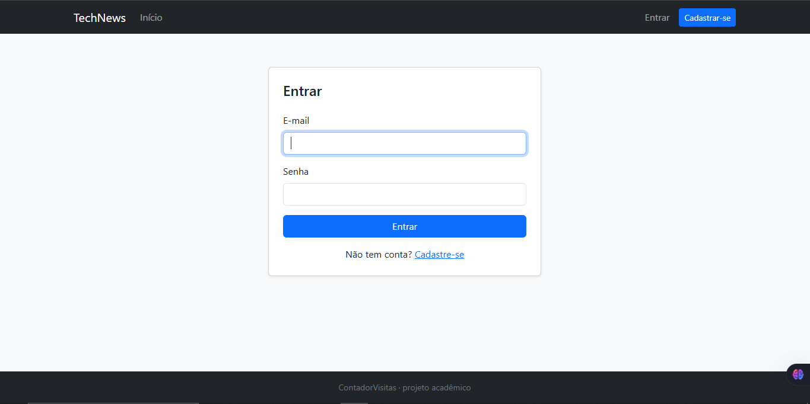
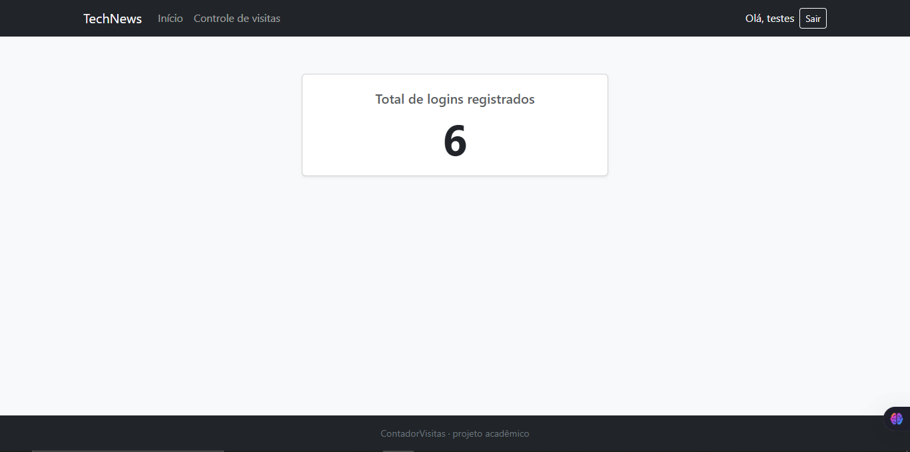

# ContadorVisitas

Projeto acadêmico: um portal de **notícias de tecnologia** com cadastro, login e um **contador de logins** gravado no arquivo `arq.in`.

## Tecnologias

- PHP 8.2+ (sem frameworks), com extensões `curl`, `SimpleXML`, `mbstring` e `PDO MySQL` (todas já vêm no XAMPP)
- MySQL/MariaDB com PDO e consultas preparadas
- HTML, CSS e [Bootstrap 5.3](https://getbootstrap.com/) via CDN
- Notícias por **RSS** (Tecnoblog e Canaltech), sem API paga e sem chave de acesso
- Nenhum JavaScript próprio (apenas o do Bootstrap, para o menu no celular)

## Funcionalidades

| Área | Acesso | O que faz |
|---|---|---|
| Página inicial (`index.php`) | Pública | Cards com as últimas notícias de tecnologia (imagem, fonte, título, resumo, data e link) |
| Cadastro (`cadastro.php`) | Visitantes | Cria a conta (nome, e-mail, senha de 8+ caracteres) |
| Login / Sair (`login.php`, `logout.php`) | Visitantes / logados | Autenticação por e-mail e senha, com sessão |
| Controle de visitas (`visitas.php`) | **Somente logados** | Mostra o total de logins registrados em `arq.in` |

## Estrutura de diretórios

```text
ContadorVisitas/
├── index.php          página inicial (notícias)
├── cadastro.php       cadastro de usuários
├── login.php          login (único ponto que incrementa o contador)
├── logout.php         encerra a sessão (POST + CSRF)
├── visitas.php        total de logins (restrita)
├── arq.in             contador (criado automaticamente; não versionado)
├── includes/
│   ├── config.example.php   modelo de configuração (versionado)
│   ├── config.php           configuração local do banco (não versionado)
│   ├── db.php               conexão PDO
│   ├── auth.php             sessão, CSRF, mensagens, proteção de páginas
│   ├── contador.php         leitura e incremento de arq.in com flock()
│   ├── rss.php              RSS + cache das notícias
│   ├── header.php           topo e navbar compartilhados
│   └── footer.php
├── assets/
│   ├── css/estilo.css       personalizações sobre o Bootstrap
│   └── img/placeholder.svg  imagem usada quando a notícia não tem foto
├── cache/             cache das notícias (noticias.json; não versionado)
├── sql/banco.sql      criação do banco e da tabela
├── .htaccess          regras do Apache (Require all denied em arq.in etc.)
└── README.md
```

## Instalação (XAMPP no Windows)

1. Copie o projeto para `C:\xampp\htdocs\ContadorVisitas`.
2. Abra o **XAMPP Control Panel** e inicie o **Apache** e o **MySQL**.
3. Crie o banco: abra `http://localhost/phpmyadmin`, vá na aba **SQL** (ou **Importar**) e execute o conteúdo de `sql/banco.sql`. Isso cria o banco `contador_visitas` e a tabela `usuarios`.
4. Crie a configuração local: copie `includes/config.example.php` para `includes/config.php`. Os valores padrão do XAMPP (host `localhost`, usuário `root`, senha vazia, banco `contador_visitas`) já funcionam. Se o seu MySQL tem senha, ajuste o arquivo.
5. Acesse **http://localhost/ContadorVisitas/**.

O `arq.in` é criado sozinho no primeiro login. As notícias precisam de internet; o `cache/` precisa permitir escrita (no XAMPP já permite).

### Tabela `usuarios`

| Coluna | Tipo | Observação |
|---|---|---|
| `id` | INT UNSIGNED | chave primária, auto incremento |
| `nome` | VARCHAR(100) | |
| `email` | VARCHAR(150) | único |
| `senha_hash` | VARCHAR(255) | hash gerado por `password_hash()`; a senha nunca é guardada |
| `data_cadastro` | DATETIME | preenchido automaticamente |

## Cadastro e login

- **Cadastro:** valida os campos, recusa e-mail já usado, grava a senha com `password_hash()` e redireciona para o login. **Não faz login automático.**
- **Login:** confere o e-mail e a senha (`password_verify()`), renova o ID da sessão e registra o login. A mensagem de erro é sempre "E-mail ou senha inválidos".
- **Logout:** só por formulário POST com token CSRF.
- Formulários protegidos por token CSRF; cookies de sessão `HttpOnly` e `SameSite=Lax` (e `Secure` em HTTPS).

## Regra de contabilização dos logins

`arq.in` conta **logins bem-sucedidos**, não visualizações de página.

| Ação | Contador |
|---|---|
| Abrir a página inicial, ler notícias, navegar, atualizar a página | não muda |
| Cadastrar-se | não muda |
| Login com senha errada | não muda |
| **Login correto** | **+1** |
| Abrir `login.php` já logado | não muda |
| Logout | não muda |
| Novo login depois do logout | **+1** |

Só o `login.php` chama `registrar_login()`, e apenas depois de validar a senha. A gravação usa `flock()`, então logins simultâneos não se perdem. Se o contador não puder ser gravado, o login **não é concluído** (o usuário vê uma mensagem genérica e o detalhe vai para o log).

## Notícias (RSS) e cache

- **Fontes (fixas no código):** Tecnoblog (`https://tecnoblog.net/feed/`) e, como alternativa, Canaltech (`https://canaltech.com.br/rss/`).
- **Fluxo:** (1) se o cache tem menos de **15 minutos**, é usado sem acessar a internet; (2) se expirou, tenta o Tecnoblog; (3) se falhar, tenta o Canaltech; (4) se as duas falharem, mostra o cache antigo com um aviso de "versão anterior"; (5) sem nenhum cache, mostra a mensagem "notícias temporariamente indisponíveis". Uma falha no RSS nunca derruba a página.
- **Exibição:** as 9 notícias mais recentes, em grade de 1, 2 ou 3 colunas conforme a tela. A imagem vem do feed (`media:thumbnail`, `media:content`, `enclosure` ou a primeira `` do conteúdo); sem imagem, usa `assets/img/placeholder.svg`.
- **Cache:** `cache/noticias.json` guarda as notícias, a fonte e a data da atualização. É gravado de forma atômica (arquivo temporário + `rename`) e uma trava (`cache/noticias.lock`) evita que várias visitas baixem o feed ao mesmo tempo. Para forçar uma atualização, apague `cache/noticias.json`.
- **Segurança:** o conteúdo do RSS é tratado como não confiável: o HTML é removido, só links `http`/`https` são aceitos, o XML é lido com `LIBXML_NONET` (e recusado se declarar entidades), só se conecta por HTTPS (com verificação de certificado), com limite de tempo e de tamanho, e toda saída é escapada.

## Proteção de arquivos

O `.htaccess` (Apache 2.4) bloqueia o acesso HTTP a `arq.in`, `includes/`, `cache/` e `sql/` e desativa a listagem de diretórios. Estas URLs devem retornar **403**: `/ContadorVisitas/arq.in`, `/ContadorVisitas/includes/config.php`, `/ContadorVisitas/cache/noticias.json`, `/ContadorVisitas/sql/banco.sql`. Requer `AllowOverride` habilitado (padrão do XAMPP).

## Arquivos não versionados

`arq.in`, `includes/config.php`, `cache/noticias.json` e os arquivos auxiliares do cache (`cache/noticias.lock`, `cache/noticias.falha`, `cache/noticias.*.tmp`). Veja o `.gitignore`.

## Solução de problemas

- **"Não foi possível conectar ao banco":** confira se o MySQL está iniciado e se `includes/config.php` existe e está correto.
- **Notícias indisponíveis:** verifique a conexão com a internet. Se o antivírus inspeciona o tráfego HTTPS (AVG, Avast, etc.), o PHP precisa confiar no certificado dele; o projeto já consulta o repositório de certificados do Windows (PHP 8.2+).
- **Detalhes técnicos:** os erros internos vão para `C:\xampp\apache\logs\error.log`; a tela mostra apenas mensagens genéricas.

## Capturas de tela

### Página inicial


### Cadastro


### Login


### Controle de visitas


## Desenvolvedores

- Murilo Santos (2º DS)
- Matheus Barros (2º DS)
